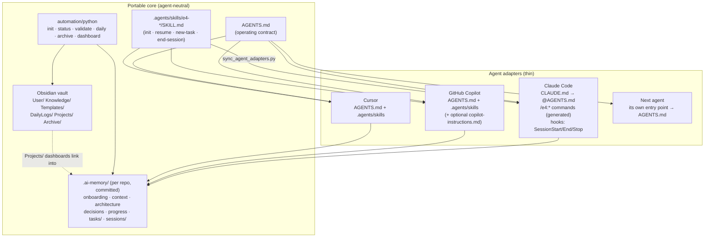
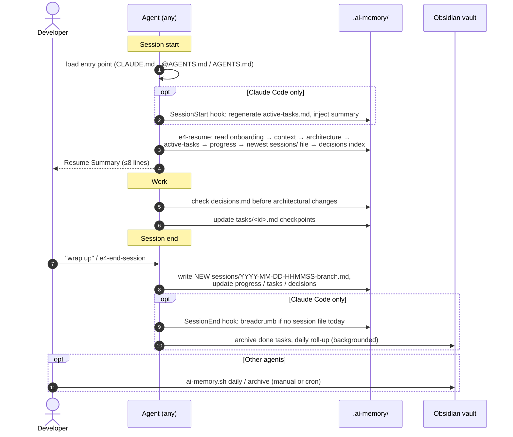

# Agent-Agnostic Architecture

> How e4 separates a **portable memory core** (Obsidian vault + `.ai-memory/` + shared workflows)
> from thin **agent adapters** (Claude Code, GitHub Copilot, Cursor, …). Read this before adding an
> agent or changing a workflow. Setup steps live in [`../agent-setup.md`](../agent-setup.md).

---

## 1. Current (before) vs proposed (after)

### Before: Claude-coupled
Everything worked, but the only operating contract was `CLAUDE.md` and the only workflow
definitions were the Claude slash commands, so no other agent could use the system.

| Component | Implementation (evidence) | Agent dependency |
|---|---|---|
| Persistent memory | `.ai-memory/` markdown in each repo (`project-template/.ai-memory/`, `init_project_memory.py`) | Portable |
| Obsidian knowledge base | `User/ Knowledge/ Templates/ DailyLogs/ Projects/ Archive/`, `docs/OBSIDIAN-INTEGRATION.md` | Portable (a few "Claude:" wordings) |
| Agent instructions | `project-template/CLAUDE.md` (the only contract) | Claude-specific *file*, mostly portable *content* |
| Workflows | `claude-config/.claude/commands/e4/*.md` (`/e4:init`, `resume`, `new-task`, `end-session`) | Claude-specific (`!` injection, `$ARGUMENTS`, `/e4:` namespace), portable logic |
| Hooks | `claude-config/.claude/hooks/*.sh` + `settings.json` (SessionStart/SessionEnd/Stop, PreToolUse guard) | Claude-specific |
| Automation | `automation/python/*.py` (stdlib), bash/PowerShell wrappers | Portable (the init stub writes `CLAUDE.md`) |
| Validation/tests | none (`CONTRIBUTING.md`: "no test suite") | — |

### After: portable core + adapters

| Component | Treatment |
|---|---|
| `.ai-memory/` format, locations, naming contracts | **Kept unchanged** |
| Obsidian vault and links | **Kept**; template wording neutralised ("AI agent:" instead of "Claude:") |
| Operating contract | **Extracted** into `project-template/AGENTS.md` (agent-neutral); `project-template/CLAUDE.md` is now a thin file that `@AGENTS.md`-imports it and adds Claude-only notes |
| Workflows | **Shared definition**: `agents-config/.agents/skills/e4-*/SKILL.md` (Agent Skills format) |
| Claude commands | **Adapter, generated**: `claude-config/.claude/commands/e4/*.md` = skill + `claude-config/overlays/*.md`, rendered by `sync_agent_adapters.py` |
| Claude hooks | **Preserved** byte-for-byte |
| Copilot | **Adapter**: reads `AGENTS.md` + `.agents/skills/` natively; optional `copilot-config/.github/copilot-instructions.md` pointer |
| Cursor | **Adapter**: reads `AGENTS.md` + `.agents/skills/` natively; no extra files |
| Automation | **Generalised**: `init_project_memory.py --with-agents-md --with-skills`; new `validate_memory.py`, `sync_agent_adapters.py` |
| Tests | **Added**: `tests/` (stdlib `unittest`) |



---

## 2. Boundaries

**The portable core owns** memory formats and locations, the read order, the update rules, the
session/task naming contracts, the workflow logic, and every script. It must never mention a
specific agent's mechanics (`/e4:` names, `` !`cmd` `` injection, `$ARGUMENTS`, `.claude/hooks`) —
`tests/test_portable_contract.py` enforces this.

**An adapter owns** only how its agent discovers the core: an entry-point file, a name mapping,
and optional lifecycle automation. It must not restate rules; it imports, points at, or is
generated from the core.

### Single source of truth and regeneration rules

| Artifact | Source of truth | Generated? | Regenerate with |
|---|---|---|---|
| Operating contract | `project-template/AGENTS.md` | no (`CLAUDE.md` imports it) | — |
| Workflow logic | `agents-config/.agents/skills/e4-*/SKILL.md` | no | — |
| Claude-only workflow bits | `claude-config/overlays/<name>.md` | no | — |
| `claude-config/.claude/commands/e4/{init,resume,new-task,end-session}.md` | skill + overlay | **yes** — never hand-edit | `python automation/python/sync_agent_adapters.py` |
| `.ai-memory/active-tasks.md` | `.ai-memory/tasks/*.md` | yes (unchanged) | `generate_status.py` |
| `Projects/*.md` dashboards | each repo's `.ai-memory/` | yes (unchanged) | `create_dashboard.py` |

`sync_agent_adapters.py --check` (also run by the test suite) fails when a generated command is stale.

#### Why generate the Claude commands instead of pointing at the skill?
Claude Code does not load `.agents/skills/`, and its commands must keep working when installed
globally in `~/.claude/commands/e4/` (where a relative pointer to `.agents/skills/` would break).
They also need Claude-only features (`` !`git status` `` pre-injection, `$ARGUMENTS`). Rendering
skill + overlay gives a self-contained command with zero runtime dependency and one place to edit.

**Overlay mechanism.** A skill marks agent-variable text as
`<!-- adapter:NAME -->neutral default<!-- /adapter:NAME -->` (an HTML comment — invisible in rendered
markdown; harmless when an agent reads raw text). The Claude overlay supplies
`<!-- region:NAME -->claude text<!-- /region:NAME -->`. Undefined regions keep the neutral default.
`/e4-<name>` becomes `/e4:<name>` in Claude output.

---

## 3. Memory lifecycle and context retrieval



Context retrieval is the same for every agent: plain file reads in a fixed order. No index, embedding
store or service is involved, so there is nothing agent-specific to port.

---

## 4. Integration points per agent

| Capability | Claude Code | GitHub Copilot | Cursor |
|---|---|---|---|
| Loads the contract | `CLAUDE.md` with `@AGENTS.md` import | `AGENTS.md` (VS Code setting `chat.useAgentsMdFile`); optionally `.github/copilot-instructions.md` | `AGENTS.md` |
| Workflows | `/e4:*` commands (generated) | Agent Skills from `.agents/skills/` | Agent Skills from `.agents/skills/` (also `/` menu) |
| Auto-load memory at start | **SessionStart hook** (mechanical) | instruction in `AGENTS.md` (model-driven) | instruction in `AGENTS.md` (model-driven) |
| Breadcrumb if wrap-up skipped | **SessionEnd hook** | — | — |
| Wrap-up nudge | **Stop hook** | — | — |
| Destructive-git guard | `guard-destructive-git.py` (PreToolUse; shipped, wire manually) | — | — |
| Reads global vault | yes, if local | local sessions only; cloud agent cannot | local only |
| Verification status | **tested** (headless `claude -p`, hooks via tests) | **static only — unverified** | **static only — unverified** |

Capabilities were taken from the vendors' documentation (Oct 2026): Copilot/VS Code loads skills
from `.github/skills/`, `.claude/skills/`, `.agents/skills/` and reads `AGENTS.md`; Cursor loads
skills from `.agents/skills/`, `.cursor/skills/` (and `.claude/skills/` for compatibility) and reads
`AGENTS.md`; Claude Code reads `AGENTS.md` only when no `CLAUDE.md` exists, so the import is required.

---

## 5. Decisions (ADR-style)

**ADR-A1 — `AGENTS.md` is the canonical contract; `CLAUDE.md` imports it.** *Status: accepted.*
Alternatives: keep `CLAUDE.md` canonical and copy it per agent (rejected: N manual copies drift);
symlink `CLAUDE.md → AGENTS.md` (rejected: symlinks are unreliable on Windows checkouts and leave no
place for Claude-only notes). Consequence: projects need both files for Claude + others; existing
projects keep their old `CLAUDE.md` until they opt in.

**ADR-A2 — Workflows are Agent Skills in `.agents/skills/`.** *Status: accepted.*
`.agents/skills/` is the vendor-neutral location read by both Copilot and Cursor. Alternative:
`.claude/skills/` (also read by both, and by Claude Code) — rejected because it brands the neutral
layer as Claude's and would turn `/e4:resume` into `/e4-resume` for Claude users (skill names can't
contain `:`), breaking muscle memory.

**ADR-A3 — Claude commands are generated from skill + overlay.** *Status: accepted.* See §2.
Alternative: hand-maintain both (rejected: drift); make commands read the skill at runtime
(rejected: breaks global install and loses `` !`cmd` `` pre-injection).

**ADR-A4 — No new runtime, service, database or dependency.** Stdlib Python and markdown only;
nothing is sent off-machine by e4 itself.

---

## 6. Known limitations

- **Copilot and Cursor have no lifecycle automation in e4.** Memory loading relies on the model
  following `AGENTS.md`; there is no breadcrumb if the user skips wrap-up. Run
  `automation/bash/ai-memory.sh daily` / `archive` manually or via cron.
- **Claude Code launched from a subdirectory skips the `@AGENTS.md` import** (external-import gate,
  verified headless). Mitigated by a fallback sentence in `CLAUDE.md` telling Claude to read the file;
  launching from the repo root avoids it.
- **Copilot cloud agent cannot read `~/AI-Vault/`.** Anything it needs must be in the repo — put
  the key standards in `.ai-memory/onboarding.md` → *Project Conventions Snapshot*.
- **Copilot/Cursor integrations are statically validated only** (spec checks, file layout). No
  Copilot or Cursor runtime was available to exercise them.
- **`/e4:init` now also installs `AGENTS.md` and `.agents/skills/`**, and its `CLAUDE.md` step
  imports `@AGENTS.md` — a deliberate behaviour change (see §7).
- The bash/PowerShell `Init-ProjectMemory` scripts are standalone re-implementations of the Python
  initializer and do **not** have the new `--with-agents-md` / `--with-skills` options.

## 7. Migration (opt-in, reversible)

Nothing is migrated automatically. To move an existing project:

```bash
python ~/AI-Vault/automation/python/init_project_memory.py <repo> --with-agents-md --with-skills
# Claude users: add one line to your existing CLAUDE.md so Claude Code loads the shared contract
#   @AGENTS.md
python ~/AI-Vault/automation/python/validate_memory.py --project <repo> --agents
```
To revert, delete `AGENTS.md` and `.agents/skills/e4-*` and drop the import line. `.ai-memory/` is
never touched.

## 8. Adding another agent

1. Read the agent's docs: where does it load project instructions and reusable skills/commands?
2. If it reads `AGENTS.md` and `.agents/skills/` → document it in `docs/agent-setup.md`; done.
3. If it needs its own entry file → add `<agent>-config/<its path>` as a **pointer** to `AGENTS.md`
   (never a copy of the rules).
4. If its command format can't consume `SKILL.md` → add `<agent>-config/overlays/` and a renderer
   in `sync_agent_adapters.py`, plus a `--check` test.
5. Lifecycle hooks are optional and adapter-owned; never move memory logic into them.
6. Mark the agent *unverified* until exercised in a real session.
